# Smart Wash — Industrial HMI

**Interface homme-machine (IHM) de supervision industrielle pour une machine de lavage, développée en C avec LVGL, mise au point sur PC (SDL2) puis déployée sur microcontrôleur ESP32 avec écran tactile 800 × 480.**


<p align="center">
  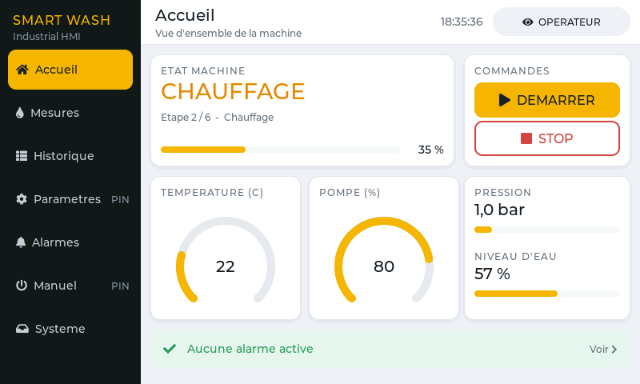
</p>

> Projet réalisé lors d'un stage technicien (2ᵉ année Génie Électrique, **ENSIT**) au sein de **Farhani General Services (FGS)**, Hammamet, sous l'encadrement de **M. Fathi Farhani** — juillet / août 2026.

---

## Sommaire

- [Présentation](#présentation)
- [Fonctionnalités](#fonctionnalités)
- [Captures d'écran](#captures-décran)
- [Architecture](#architecture)
- [Structure du dépôt](#structure-du-dépôt)
- [Lancer le simulateur sur PC](#lancer-le-simulateur-sur-pc)
- [Déployer sur ESP32](#déployer-sur-esp32)
- [Utilisation](#utilisation)
- [Normes et bonnes pratiques](#normes-et-bonnes-pratiques)
- [Limites connues](#limites-connues)
- [Perspectives](#perspectives)
- [Auteure](#auteure)

---

## Présentation

Les machines de lavage industrielles sont encore souvent pilotées par des afficheurs à voyants ou des écrans texte, sans historique ni traçabilité. **Smart Wash** propose une IHM graphique et tactile, économique et sûre, capable d'afficher en temps réel les paramètres critiques du procédé tout en restant compatible avec les ressources limitées d'un microcontrôleur.

Le développement s'est fait en deux temps :

1. **Simulation sur PC** : LVGL + SDL2 (la souris simule le tactile), pour itérer rapidement sans matériel.
2. **Portage sur ESP32** : seule la **couche basse** change (envoi des pixels à l'écran, lecture du tactile, tick). Le code de l'interface et la logique métier restent **strictement identiques**.

> Les grandeurs affichées (température, pression, niveau, pompe) sont **simulées** de façon cohérente avec la phase du cycle, en attendant le raccordement à des capteurs réels.

## Fonctionnalités

| Domaine | Détail |
|---|---|
| **Supervision temps réel** | Cycle en 6 étapes (Remplissage, Chauffage, Lavage, Rinçage, Essorage, Terminé), température, pression, niveau d'eau, vitesse de pompe — mise à jour toutes les 250 ms |
| **7 écrans** | Accueil, Mesures, Historique, Paramètres, Alarmes, Manuel, Système — menu latéral permanent |
| **Alarmes (ISA-18.2)** | 6 alarmes surveillées, cycle de vie **active → acquittée → résolue**, notification, pastille sur le menu, bandeau rouge, jauge en rouge |
| **Gestion des accès (RBAC)** | Profils **Opérateur** (par défaut) et **Administrateur** ; écrans *Paramètres* et *Manuel* protégés par code PIN |
| **Authentification PIN** | Clavier tactile, saisie masquée, **3 essais** puis **blocage 30 s** avec compte à rebours |
| **Traçabilité** | Historique des cycles (date, durée, résultat, cause) + journal des actions et de sécurité (qui, quoi, quand) |
| **Consignes** | Température cible (20–90 °C) et vitesse de pompe (0–100 %), chaque modification est journalisée |
| **Test de la chaîne d'alarme** | Simulation d'une surpression de 6,8 bar depuis l'écran Système |
| **Portabilité** | Même code C sur PC (SDL2) et ESP32-S3 (ESP-IDF + BSP Espressif), architecture en 3 couches |

### Alarmes surveillées

| Code | Alarme | Condition | Gravité |
|---|---|---|---|
| ALM-001 | Surchauffe | Température > 80 °C | Critique |
| ALM-002 | Surpression | Pression > 6,0 bar | Critique |
| ALM-003 | Niveau bas | Niveau < 20 % pendant chauffage ou lavage | Critique |
| ALM-004 | Niveau élevé | Niveau > 95 % | Avertissement |
| ALM-005 | Arrêt d'urgence | Arrêt d'urgence engagé | Critique |
| ALM-006 | Pompe arrêtée | Pompe demandée avec une consigne nulle | Avertissement |

### Permissions

| Fonction | Opérateur | Administrateur |
|---|:---:|:---:|
| Consulter les écrans de supervision | ✅ | ✅ |
| Lancer / arrêter un cycle (Accueil) | ✅ | ✅ |
| Acquitter les alarmes | ✅ | ✅ |
| Tester la chaîne d'alarme | ✅ | ✅ |
| Modifier les consignes (Paramètres) | ❌ | ✅ |
| Commande manuelle (Manuel) | ❌ | ✅ |

## Captures d'écran

> Captures réalisées avec le simulateur PC ; le rendu est identique sur la cible ESP32.

| Accueil | Accueil — alarme de surchauffe |
|---|---|
|  | 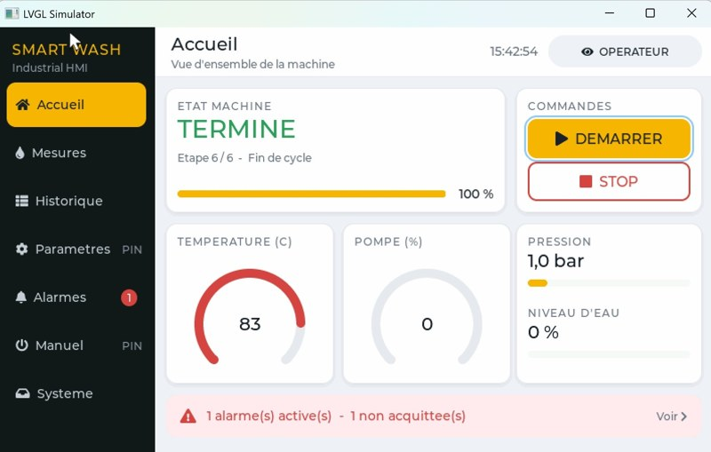 |
| **Mesures** | **Alarmes** |
| 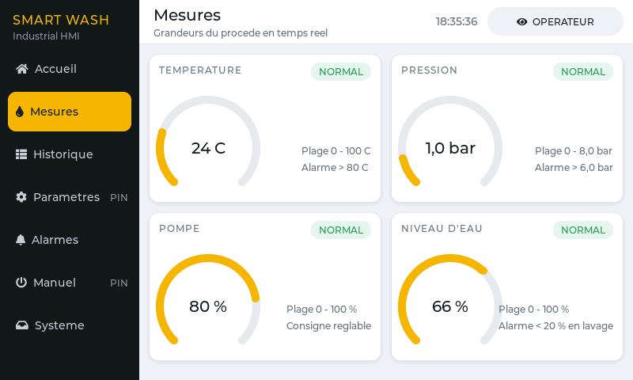 | 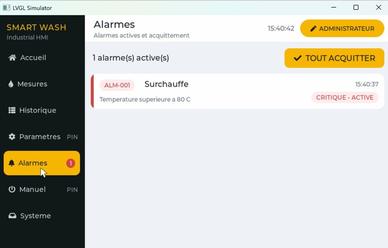 |
| **Historique et journal de sécurité** | **Paramètres (administrateur)** |
| 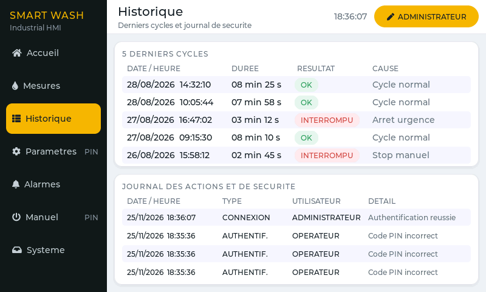 | 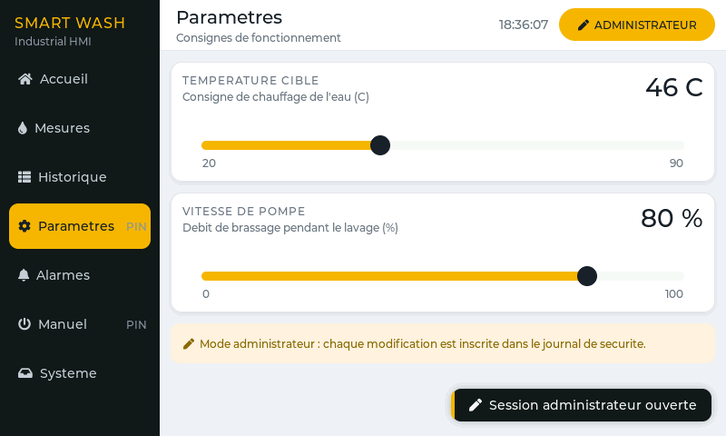 |
| **Code PIN incorrect** | **Blocage après 3 échecs** |
| 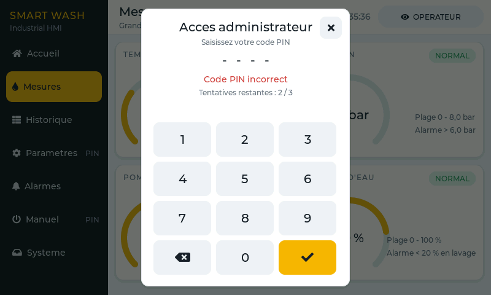 | 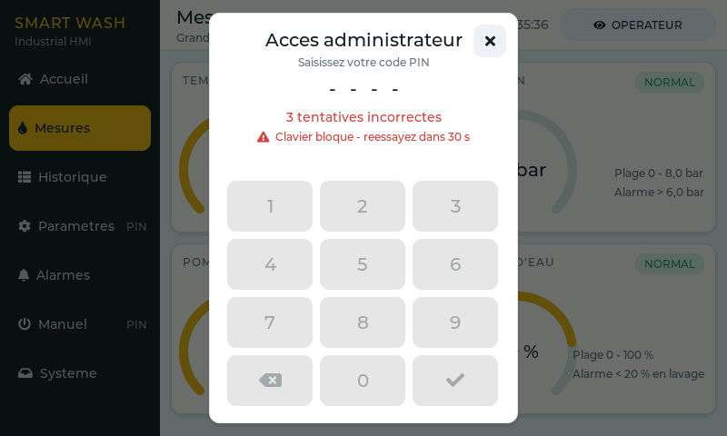 |
| **Manuel (administrateur)** | **Système** |
| 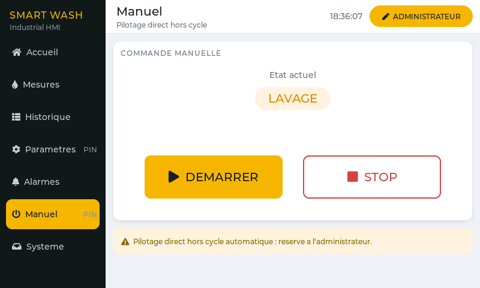 | 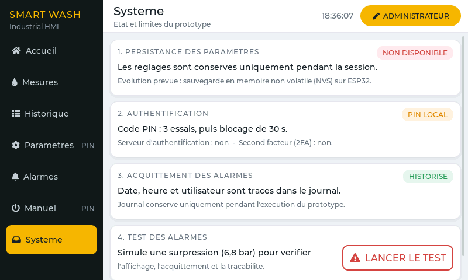 |

## Architecture

L'application est organisée en **trois couches découplées**. Seule la couche du bas dépend de la cible.

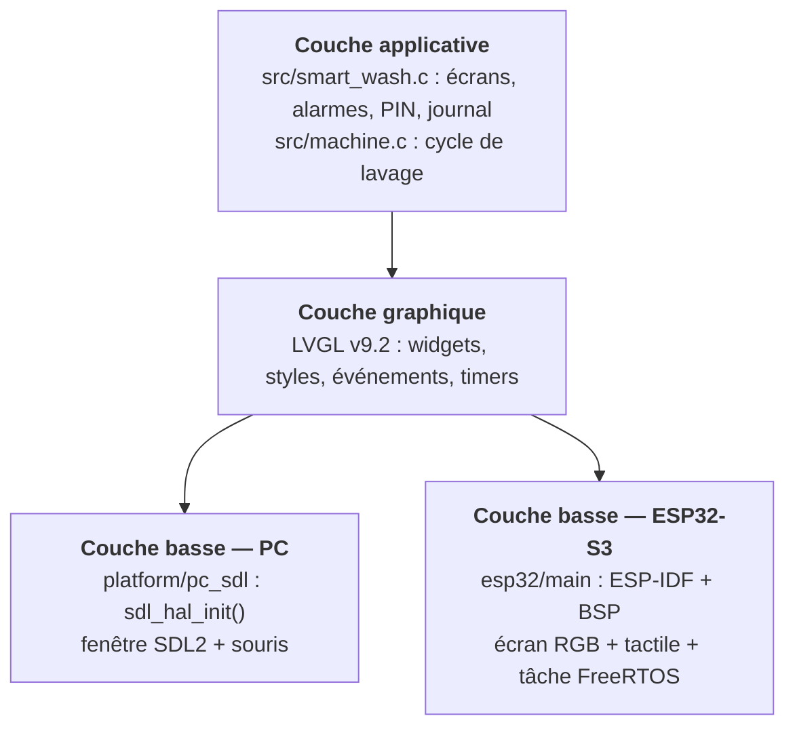

Le passage du PC à l'ESP32 ne touche que l'initialisation :

| Rôle | PC (`platform/pc_sdl/main.c`) | ESP32-S3 (`esp32/main/main.c`) |
|---|---|---|
| Initialisation | `lv_init()` + `sdl_hal_init(800, 480)` | `bsp_display_start()` |
| Affichage | fenêtre SDL2 (pilote LVGL intégré) | panneau RGB via le BSP (`esp_lvgl_port`) |
| Tactile | souris | contrôleur tactile via le BSP |
| Boucle `lv_timer_handler()` | `while (1)` dans `main()` | tâche FreeRTOS du BSP |

Dans les deux cas, l'interface démarre par le même appel : `smart_wash_start()`.

Cadencement : la boucle principale appelle `lv_timer_handler()` toutes les ~5 ms ; un minuteur LVGL de **250 ms** fait avancer la simulation, évalue les alarmes et rafraîchit l'écran affiché ; un minuteur de **1 s** met à jour l'horloge.

Plus de détails : [docs/ARCHITECTURE.md](docs/ARCHITECTURE.md).

## Structure du dépôt

```
smart-wash-hmi/
├── CMakeLists.txt            # build du simulateur PC (télécharge LVGL v9 automatiquement)
├── include/
│   └── lv_conf.h             # configuration LVGL v9 du simulateur
├── src/                      # ── code portable (identique PC / ESP32) ──
│   ├── smart_wash.c          # toute l'IHM : écrans, alarmes, PIN, historique, journal
│   ├── smart_wash.h          # smart_wash_start()
│   ├── machine.c             # modèle de la machine (cycle, température)
│   └── machine.h
├── platform/
│   └── pc_sdl/               # ── simulateur PC ──
│       ├── main.c            # lv_init() + sdl_hal_init() + boucle
│       └── hal/hal.c         # fenêtre SDL2, souris, clavier
├── esp32/                    # ── projet ESP-IDF (cible ESP32-S3) ──
│   ├── CMakeLists.txt
│   ├── sdkconfig.defaults    # PSRAM octale, 240 MHz, LVGL, écran 800x480
│   ├── partitions.csv
│   └── main/
│       ├── main.c            # bsp_display_start() + smart_wash_start()
│       ├── CMakeLists.txt    # compile aussi le code portable ../../src
│       └── idf_component.yml # BSP esp32_s3_lcd_ev_board + LVGL 9.2
├── docs/
│   ├── ARCHITECTURE.md
│   └── images/               # captures d'écran
└── .github/workflows/        # compilation automatique (PC + ESP-IDF)
```

## Lancer le simulateur sur PC

### Prérequis

- Un compilateur C (GCC / MinGW), **CMake ≥ 3.18**, **Git**
- La bibliothèque **SDL2**

LVGL v9.2.2 est téléchargé automatiquement par CMake au premier build (ou utilisé depuis `lib/lvgl` s'il est présent).

### Windows (MSYS2)

1. Installer [MSYS2](https://www.msys2.org/), puis dans le terminal **MSYS2 UCRT64** :
   ```bash
   pacman -S --needed git mingw-w64-ucrt-x86_64-gcc mingw-w64-ucrt-x86_64-cmake mingw-w64-ucrt-x86_64-ninja mingw-w64-ucrt-x86_64-SDL2
   ```
2. Compiler et lancer :
   ```bash
   git clone https://github.com/<votre-compte>/smart-wash-hmi.git
   cd smart-wash-hmi
   cmake -B build -G Ninja
   cmake --build build
   ./build/smart_wash.exe
   ```

> Avec VS Code : ouvrir le dossier, installer l'extension **CMake Tools**, choisir le kit *GCC (ucrt64)* puis **Build** / **Run**. Si le compilateur n'est pas détecté, ajouter `C:\msys64\ucrt64\bin` à la variable d'environnement `PATH`.

### Linux (Debian / Ubuntu)

```bash
sudo apt install build-essential cmake git libsdl2-dev
cmake -B build && cmake --build build -j
./build/smart_wash
```

### macOS

```bash
brew install cmake sdl2
cmake -B build && cmake --build build -j
./build/smart_wash
```

## Déployer sur ESP32

### Matériel

- Carte **ESP32-S3** avec PSRAM octale (ex. **ESP32-S3-LCD-EV-Board** d'Espressif)
- Écran RGB **800 × 480** tactile (sous-carte 3 de l'EV-Board)

> Pour l'écran 480 × 480, remplacez `CONFIG_BSP_LCD_SUB_BOARD_800_480=y` par `CONFIG_BSP_LCD_SUB_BOARD_480_480=y` dans [`esp32/sdkconfig.defaults`](esp32/sdkconfig.defaults). Attention : l'interface est dessinée pour 800 × 480.

### Compilation et téléversement (ESP-IDF)

1. Installer [ESP-IDF v5.x](https://docs.espressif.com/projects/esp-idf/en/latest/esp32s3/get-started/index.html) (ou l'extension **ESP-IDF** de VS Code).
2. Ouvrir un terminal ESP-IDF, puis :
   ```bash
   cd esp32
   idf.py set-target esp32s3       # une seule fois
   idf.py build
   idf.py -p COM3 flash monitor    # adapter le port (ex. /dev/ttyUSB0 sous Linux)
   ```

Au premier build, l'*IDF Component Manager* télécharge automatiquement le BSP de la carte et **LVGL 9.2** (voir [`esp32/main/idf_component.yml`](esp32/main/idf_component.yml)).

Le composant `main` compile `esp32/main/main.c` **et** le code portable de `src/` : aucune copie du code entre le simulateur et la carte.

Sur ESP32, la carte n'a pas d'horloge temps réel : l'heure affichée part de zéro au démarrage (une synchronisation SNTP via le Wi-Fi est une évolution possible).

## Utilisation

| Action | Comment |
|---|---|
| Lancer un cycle | Accueil → **DÉMARRER** ; le cycle parcourt les 6 étapes puis apparaît dans l'historique avec le résultat *OK* |
| Arrêter un cycle | **STOP** → enregistré *Interrompu – Stop manuel* |
| Passer administrateur | Toucher le badge **OPÉRATEUR** (en haut à droite) ou un écran marqué **PIN** |
| Code PIN | `2002` — défini dans [`src/smart_wash.c`](src/smart_wash.c) (`ADMIN_PIN`) |
| Se déconnecter | Toucher le badge **ADMINISTRATEUR** |
| Tester la chaîne d'alarme | Système → **LANCER LE TEST** (surpression simulée à 6,8 bar) |
| Acquitter | Alarmes → **TOUT ACQUITTER** (tracé dans le journal) |

## Normes et bonnes pratiques

- **ANSI/ISA-101.01** — IHM « haute performance » : fond gris neutre, cartes blanches, couleur vive réservée à l'état du procédé (vert = normal, orange = en cours / avertissement, rouge = arrêt / alarme critique), jaune réservé aux actions.
- **ANSI/ISA-18.2** — cycle de vie des alarmes (active, acquittée, résolue) et traçabilité des acquittements.
- **RBAC** (NIST) — contrôle d'accès basé sur les rôles.
- **NIST SP 800-63B** — limitation du nombre de tentatives d'authentification.

## Limites connues

Ces limites sont aussi affichées dans l'écran **Système** de l'interface :

- Données **simulées** (pas encore de capteurs réels).
- **Pas de persistance** : consignes et journal sont perdus à la mise hors tension (RAM uniquement).
- Authentification **élémentaire** : un code PIN unique, stocké et vérifié localement, sans second facteur.
- Seuils d'alarme **fixés dans le programme** (non modifiables depuis l'interface).
- Pas de caractères accentués ni de symbole « ° » à l'écran : la police LVGL intégrée ne couvre que l'ASCII.
- Validation sur ESP32 restée courte : performances (fluidité, mémoire) non mesurées.

## Perspectives

- Acquisition réelle des grandeurs (capteurs, Modbus RTU / RS-485).
- Sauvegarde des consignes et du journal en mémoire non volatile (NVS / LittleFS).
- PIN par utilisateur, stocké sous forme hachée.
- Seuils d'alarme configurables et courbes d'évolution (`lv_chart`).
- Police avec accents et symbole degré (LVGL font converter).
- Découpage de `smart_wash.c` en un fichier par écran.
- Supervision à distance (Wi-Fi, MQTT).

## Auteure

**Eya Ziedi** — élève ingénieure en Génie Électrique, École Nationale Supérieure d'Ingénieurs de Tunis (ENSIT).

Stage réalisé chez **Farhani General Services**, Hammamet — encadrant industriel : **M. Fathi Farhani**.

## Licence

Distribué sous licence MIT — voir [LICENSE](LICENSE).
LVGL est distribué sous licence MIT, ESP-IDF et le BSP Espressif sous licence Apache 2.0, SDL2 sous licence zlib.
