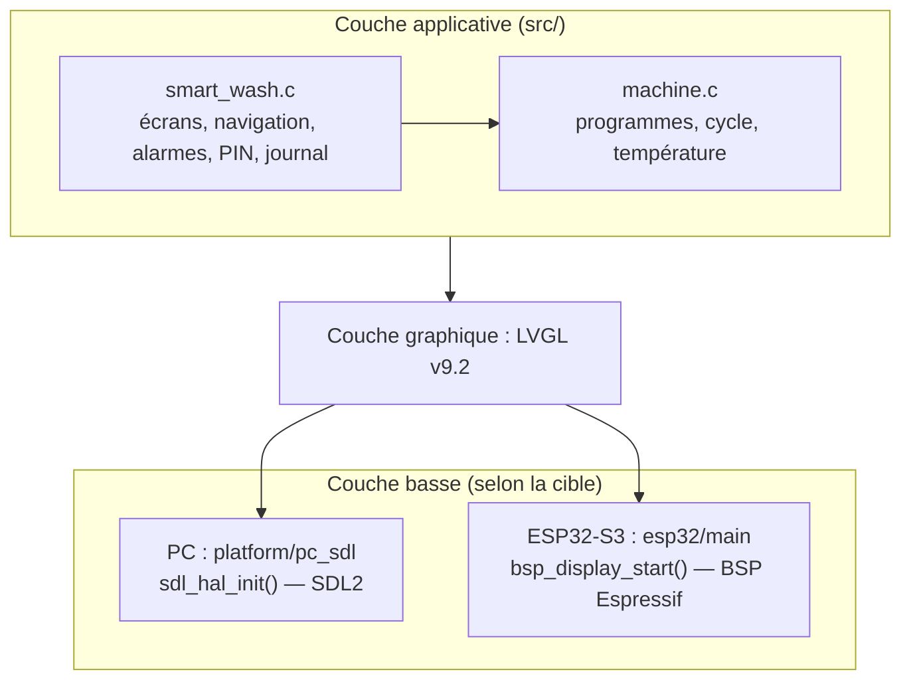
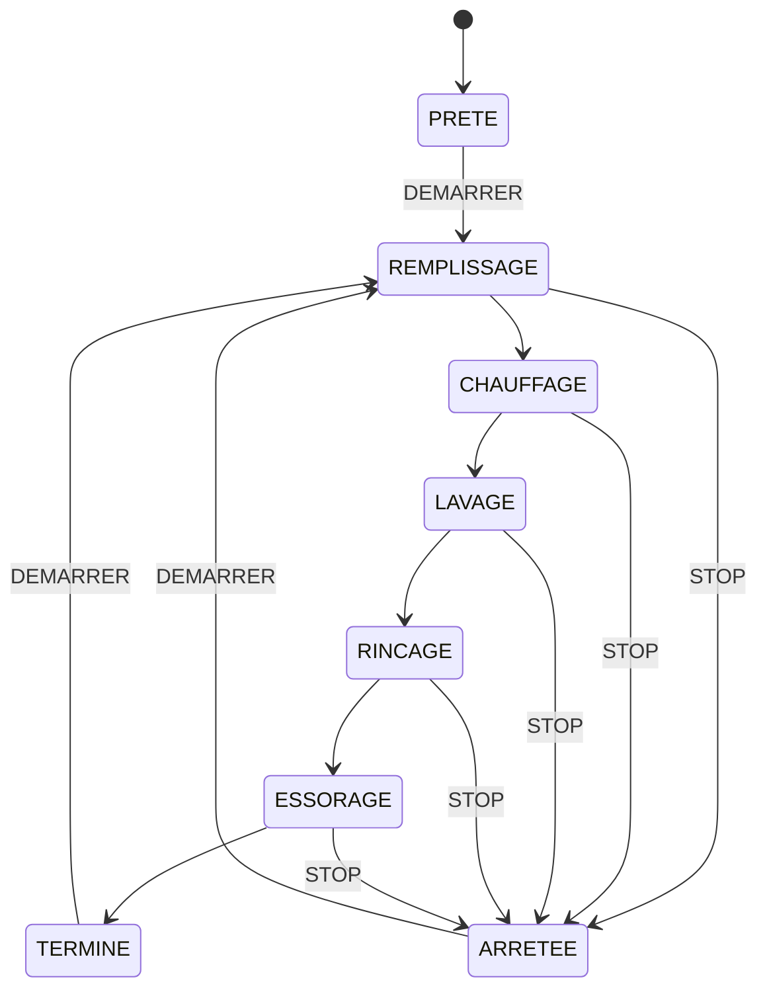
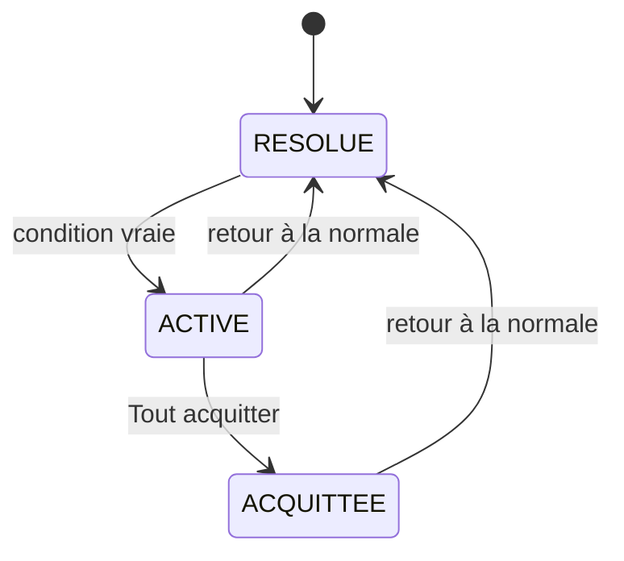
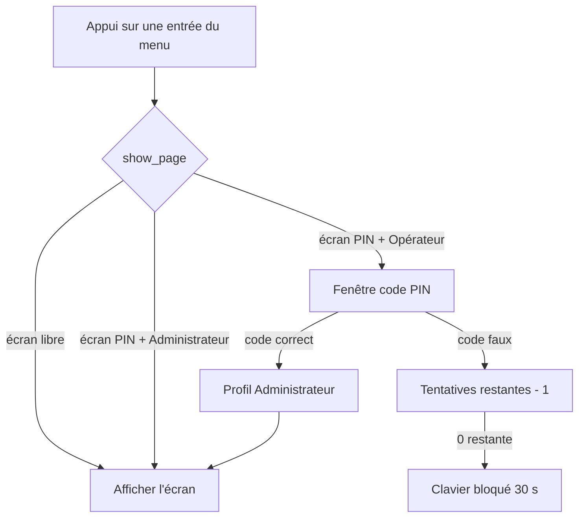

# Architecture logicielle — Smart Wash HMI

## 1. Trois couches découplées

`src/` ne contient **aucun code spécifique à une cible**. Chaque cible initialise LVGL et ses pilotes, puis appelle `smart_wash_start()` :

| | PC (`platform/pc_sdl/main.c`) | ESP32-S3 (`esp32/main/main.c`) |
|---|---|---|
| Initialisation | `lv_init()` + `sdl_hal_init(800, 480)` | `bsp_display_start()` |
| Boucle LVGL | `while (1) { lv_timer_handler(); usleep(); }` | tâche FreeRTOS de `esp_lvgl_port` |
| Démarrage de l'IHM | `smart_wash_start()` | `smart_wash_start()` sous `bsp_display_lock()` |

## 2. Organisation de `smart_wash.c`

| Section | Contenu |
|---|---|
| 1. Configuration | Dimensions (800 × 480), code PIN, seuils d'alarme, palette ISA-101, polices Montserrat |
| 2. Données | État machine, 6 alarmes, historique des cycles, journal de sécurité |
| 3. Briques graphiques | Fonctions réutilisables : carte, jauge, puce d'état, barre, bouton, notification (toast) |
| 4. Structure | Menu latéral, bandeau supérieur (horloge, badge de profil), zone de contenu, `show_page()` |
| 5. Écrans | Accueil, Mesures, Historique, Paramètres, Alarmes, Manuel, Système |
| 6. Authentification | Fenêtre modale PIN : clavier, 3 essais, blocage 30 s |
| 7. Logique | Simulation des grandeurs, évaluation des alarmes, transitions de cycle, journal |
| 8. Démarrage | `smart_wash_start()` : construction de l'IHM et des minuteurs |

## 3. Cadencement

- `lv_timer_handler()` est appelé en boucle (toutes les 5 à 20 ms) : LVGL ne redessine que les zones modifiées.
- Minuteur de **250 ms** (`sim_timer_cb`) : `machine_update()`, simulation de la pression et du niveau, détection de fin ou d'interruption de cycle, évaluation des alarmes, mise à jour des widgets.
- Minuteur de **1 s** (`clock_timer_cb`) : horloge du bandeau.

## 4. Cycle de lavage

`machine.c` avance d'une étape par seconde (`lv_tick_get()`). La durée totale dépend du programme (*Lavage*, *Rinçage*, *Essorage*), de la durée de lavage (5 à 60 s) et du temps de chauffe (+2 °C par seconde jusqu'à la consigne, 30 à 90 °C).

Un cycle terminé est enregistré *OK – Cycle normal* ; un cycle arrêté, *Interrompu – Stop manuel* (ou *Arrêt urgence*).

## 5. Alarmes (ISA-18.2)

L'apparition d'une alarme déclenche une notification, une pastille rouge sur l'entrée « Alarmes » du menu, le bandeau rouge de l'accueil et le passage au rouge de la jauge concernée. Chaque acquittement est inscrit dans le journal avec l'utilisateur.

## 6. Navigation et contrôle d'accès

Tous les changements d'écran passent par `show_page()`, ce qui garantit qu'aucun autre chemin ne mène à un écran protégé.
